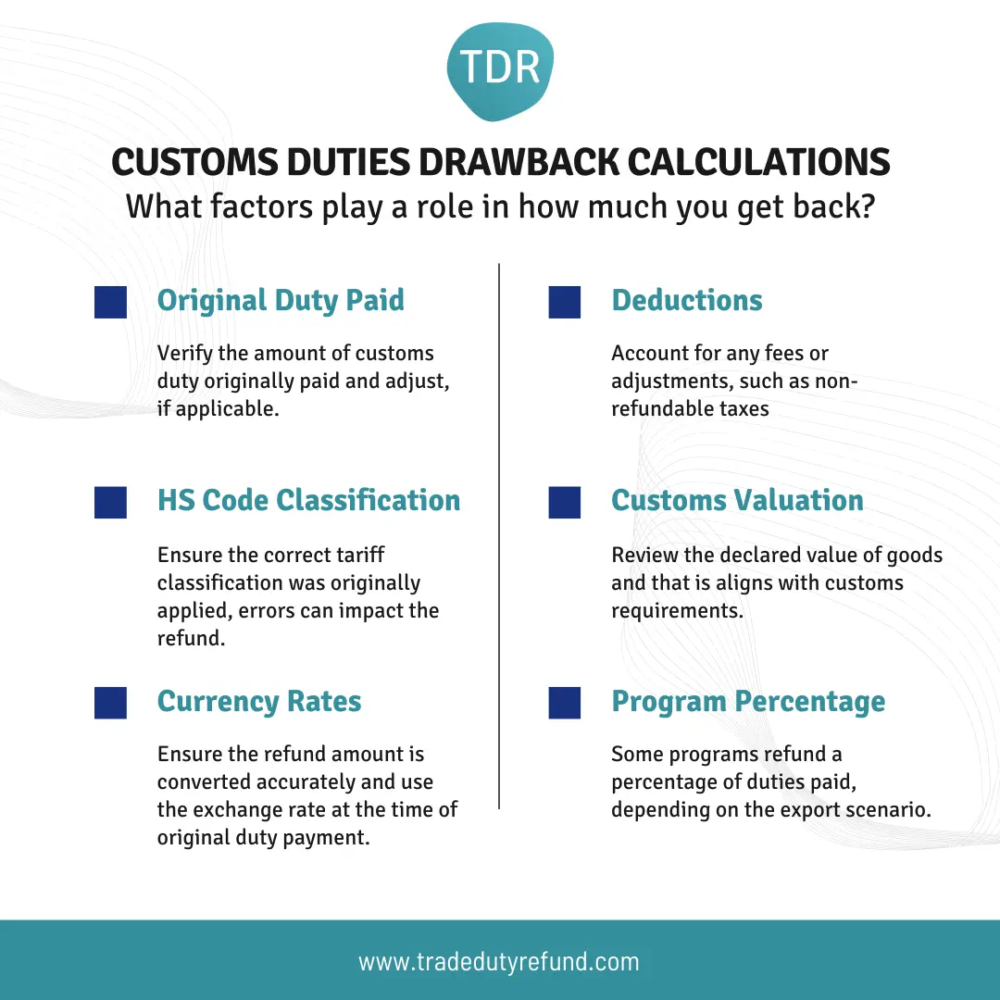

> When trading internationally, customs duties can significantly impact your bottom line. Duty drawback programs provide an opportunity to reclaim duties paid during importation, potentially saving your business substantial costs. Learn how to maximize your refunds in the EU, UK, and US.

### Key Factors in Duty Drawback Calculations

Several critical elements influence how much you can claim under duty drawback programs:

1. **Original Duty Paid**  
   Start by verifying the customs duties initially paid. If any adjustments or corrections apply, ensure they are factored into your claim.

2. **HS Code Classification**  
   The accuracy of your tariff classification is essential. Mistakes in HS codes can lead to reduced refunds or even rejections.

3. **Currency Rates**  
   Refund amounts must be converted using the exchange rate at the time of the original duty payment to ensure accurate reimbursement.

4. **Deductions**  
   Consider fees like non-refundable taxes, which may reduce the total amount refunded.

5. **Customs Valuation**  
   The declared value of goods must align with customs requirements to avoid complications in your claims.

6. **Program Percentage**  
   Different regions refund varying percentages of duties paid. Let’s explore how this works in the EU, UK, and US.

---

### Duty Drawback in the European Union and the UK

In the EU and the UK, the duty drawback program allows a **100% refund of the customs duties and VAT paid**. This is especially advantageous for businesses engaged in re-exporting goods or for items imported and later destroyed. To successfully claim a refund:

- Maintain accurate import/export documentation.  
- Ensure goods meet all customs eligibility requirements.  
- File your claims timely and completely.

For retailers, the most common cases are customer returns and re-exported inventory. See how this works on our pages for [EU duty drawback](https://tradedutyrefund.com/TDR-Duty-Drawback-in-the-EU.html) and [UK duty drawback](https://tradedutyrefund.com/TDR-Duty-Drawback-in-the-UK.html), or read about [Returned Goods Relief in the EU](https://tradedutyrefund.com/TDR-returned-goods-relief-in-the-EU.html) and [in the UK](https://tradedutyrefund.com/TDR-returned-goods-relief-in-the-UK.html) when goods that were exported come back.

---

### Duty Drawback in the United States

In the US, businesses can recover **up to 99% of duties paid**, making it a valuable program for exporters. Types of duty drawback in the US include:

- **Unused Merchandise Drawback**: For goods exported without being used.  
- **Manufacturing Drawback**: When imported goods are used in manufacturing and the finished product is exported.  
- **Rejected Merchandise Drawback**: Covers returns due to defects or non-conformance.

**Worked example:** a company pays $10,000 in duties on imported goods and later exports eligible goods. A claim for the full amount could recover up to $9,900 (99%). Eligibility, documentation and deadlines still determine what is actually refunded.

Learn how we handle claims on our [US duty drawback](https://tradedutyrefund.com/TDR-Duty-Drawback-in-the-US.html) page.

---

### Conclusion: Maximize Your Duty Refunds

Duty drawback programs can save businesses a substantial amount of money by recovering duties paid on imports. Whether operating in the EU, UK, or US, understanding the calculation process and regional regulations is critical to maximizing your claims.  

For additional insights, tools, and support, visit [**Trade Duty Refund**](https://tradedutyrefund.com) and let the experts guide you in reclaiming your customs duties efficiently.